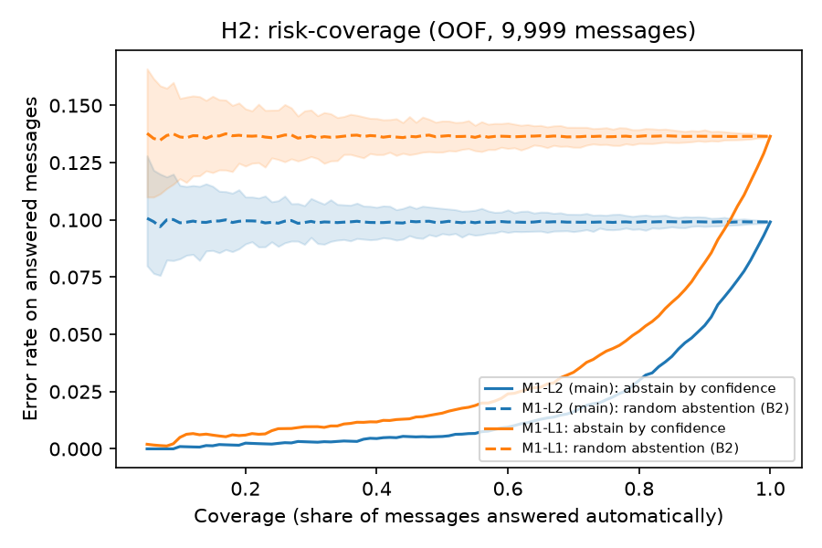
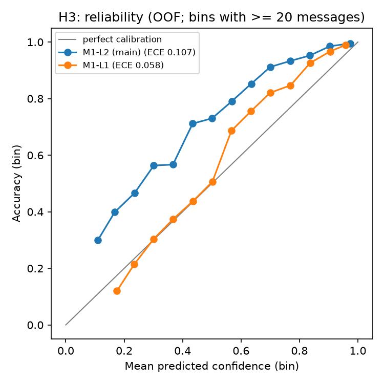
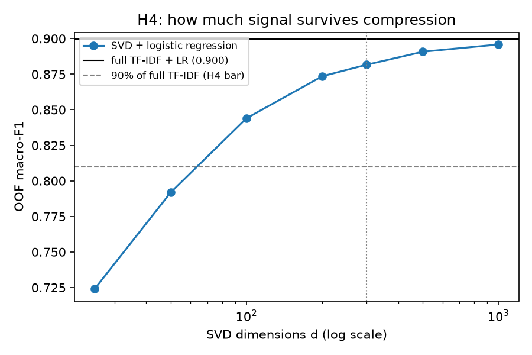
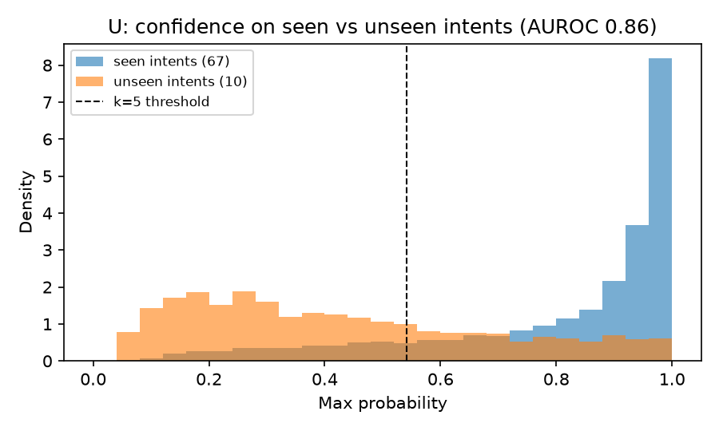
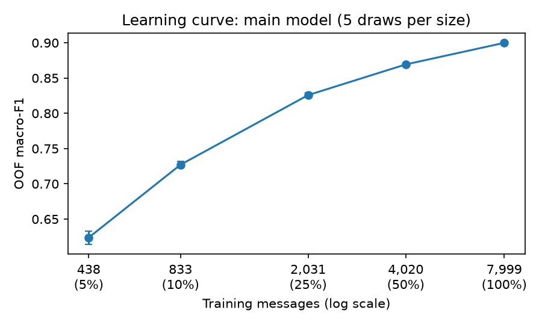

# Knowing When to Ask a Human: Banking Intent Classification with Calibrated Handoff

ES 335 · Machine Learning 2026 course project.

**Research question:** why do classical machine-learning intent classifiers fail on banking customer queries, and when should they abstain instead of answering? Four hypotheses are tested:

- **H1:** most errors come from overlapping intent definitions, not from weak models.
- **H2:** confidence-based abstention beats random abstention at every coverage level.
- **H3:** the most accurate model is not necessarily the best calibrated.
- **H4:** low-dimensional SVD features keep most of the signal in the full TF-IDF features.

An exploratory test also asks whether the model can reject intents it never saw in training.

The hypotheses, split rules, and decision criteria were pre-registered in [PREREGISTRATION.md](PREREGISTRATION.md) before any model was trained.

- **Live site:** https://semsem1313.github.io/banking77-intent-abstention/ (in progress)
- **Data:** BANKING77 (Casanueva et al., 2020, arXiv:2003.04807), CC BY 4.0. It's downloaded from [PolyAI-LDN/task-specific-datasets](https://github.com/PolyAI-LDN/task-specific-datasets) at a pinned commit, with SHA-256 checks. There are 10,003 training and 3,080 test messages across 77 intents.

## Evaluation design

- **The test set is used once.** `data/raw/test.csv` is read only by `src/evaluate_final.py`, in a single run after all models are frozen. A test (`tests/test_leakage_guard.py`) enforces this.
- **Training split** (`src/split.py`, outputs in `data/processed/`):
  - 4 exact duplicates are removed, leaving 9,999 messages.
  - Near-duplicates (word 1–2 gram TF-IDF cosine ≥ 0.90) are grouped into connected components (153 pairs).
  - Folds are 5-fold `StratifiedGroupKFold`, stratified by intent and grouped by near-duplicate component, for seeds 335–339. `fold_335` is the main assignment.
  - **Sensitivity check** (pre-registration amendment, 2026-10-29): a stricter grouping at cosine ≥ 0.80 (`fold_sens`). It's used to check that near-duplicates don't inflate CV scores.
  - 10 intents are held out at random (seed 2026) for the unseen-intent experiment.
- **All tuning, thresholds, and hypothesis decisions** use out-of-fold predictions from these folds.
- **All learned preprocessing** (TF-IDF, SVD, scaling, calibration) is fit inside each training fold.

## Reproduce

Tested on Python 3.14 (Windows).

```bash
python -m venv .venv
.venv/Scripts/python -m pip install -r requirements.txt
.venv/Scripts/python -m src.download_data
.venv/Scripts/python -m src.split            # ~20 s
.venv/Scripts/python -m src.baselines        # ~2.5 min (bootstrap CIs)
.venv/Scripts/python -m src.tune             # ~10 min on 16 cores (M1 grid + robustness checks)
.venv/Scripts/python -m src.tune_more        # ~5 min (KNN, SVD + LR, random forest, H4 curve)
.venv/Scripts/python -m src.error_predictor  # ~1 min (E1)
.venv/Scripts/python -m src.analysis         # ~30 s (H2, H3, figures)
.venv/Scripts/python -m src.h1               # seconds (H1; creates reports/error_labels.csv for hand labels)
.venv/Scripts/python -m src.experiments      # ~5 min (unseen-intent test, learning curves)
.venv/Scripts/python -m src.evaluate_final --dry-run   # ~5 min; full rehearsal on fold 0, never opens test.csv
.venv/Scripts/python -m src.evaluate_final   # run once, on frozen models
.venv/Scripts/python -m src.export_web
.venv/Scripts/python -m pytest               # ~35 s
```

## Status

| Step | State |
|---|---|
| Pre-registration, data download, split, tests | Done |
| Baselines (B0 majority, B1 keyword rule, B2 random abstention) | Done |
| Main model M1 (TF-IDF + logistic regression, L2 and L1), OOF probabilities | Done |
| H2 abstention, H3 calibration (`src/analysis.py`) | Done (cross-validated) |
| M2 KNN, M3 SVD + LR (H4), M4 random forest (`src/tune_more.py`); E1 error predictor (`src/error_predictor.py`) | Done (cross-validated) |
| H1 error analysis (`src/h1.py`, including the author's 50 hand labels), unseen intents and learning curves (`src/experiments.py`) | Done |
| **Final test-set run (`src/evaluate_final.py`), run once on commit `c21163f`** | **Done** |
| Website (`docs/`) | Next |

## Final test-set results (3,080 messages, run once)

All models and settings were frozen from cross-validation, then refit on all 9,999 training messages and scored **once** on the official test set (`reports/final/final_test.json`; `reports/final/LOCK` records the run). Brackets show 95% bootstrap CIs.

| Model | Accuracy | Macro-F1 |
|---|---|---|
| B0: majority intent | 0.013 | 0.000 |
| B1: keyword rule, k=20 (strongest baseline) | 0.643 [0.626, 0.660] | 0.626 [0.607, 0.638] |
| M2: KNN on TF-IDF | 0.849 | 0.849 [0.836, 0.859] |
| M4: random forest on SVD-300 | 0.850 | 0.849 [0.835, 0.859] |
| M2: KNN on SVD-300 | 0.852 | 0.851 [0.838, 0.861] |
| M1-L1 | 0.880 | 0.880 [0.868, 0.890] |
| M3: SVD-300 + logistic regression | 0.893 | 0.893 [0.882, 0.903] |
| **M1-L2: word+char TF-IDF + L2 logistic regression (main)** | **0.913 [0.903, 0.922]** | **0.913 [0.901, 0.922]** |

- **Versus the strongest baseline:** +0.287 macro-F1 (paired bootstrap 95% CI [+0.273, +0.304]).
- **Train/test overlap:** 134 test messages (4.4%) are near-duplicates (cosine ≥ 0.90) of training messages. Without them, M1-L2 scores 0.911 macro-F1, so the overlap doesn't drive the result.
- **Why the test score beats cross-validation (0.900):** the final model trains on all 9,999 messages instead of about 8,000 per fold, and the learning curve is still rising.

| Hypothesis | Test-set evidence | Verdict |
|---|---|---|
| **H1** overlapping definitions | 59.5% of errors fall inside the OOF-defined confusable groups. Merging them lifts accuracy 0.913 → 0.965. Top-3 accuracy 0.976. Coarse-category accuracy 0.967. Hand labels: 66% of errors are ambiguous labels. | Supported |
| **H2** confidence beats random abstention | The CI is below 0 at every coverage level 0.50–0.95. AURC 0.015 vs 0.087 random. | Supported |
| **H3** most accurate ≠ best calibrated | M1-L2 ECE 0.087 [0.079, 0.097] vs M1-L1 0.051 [0.045, 0.063]. All models are underconfident; the random forest has ECE 0.443. | Supported |
| **H4** SVD keeps most of the signal | 100 dims reach 93.9% of full TF-IDF macro-F1, and 300 dims reach 97.9%. | Supported |
| **U** unseen intents (exploratory) | AUROC 0.882. At k=5, 68.5% of unseen-intent messages are handed off, vs 12.9% of seen ones. | — |

**Frozen handoff thresholds applied to the test set** (chosen on OOF data, never tuned on test):

| k | Threshold | Answered | Accuracy on answered | Cost / message | Answer all | Best possible on test |
|---|---|---|---|---|---|---|
| 2 | 0.228 | 97.9% | 92.5% | 0.168 | 0.175 | 0.166 |
| 5 | 0.560 | 85.3% | 97.0% | 0.277 | 0.437 | 0.274 |
| 10 | 0.685 | 79.1% | 98.1% | 0.361 | 0.873 | 0.350 |

The thresholds chosen on cross-validation land within 0.01 of the best cost achievable on the test set.

**Error predictor E1 on test:** AUROC 0.924 vs 0.908 for max probability; AURC 0.0137 vs 0.0152.

**Learning curve on test** (macro-F1): 0.663 at 5%, 0.760 at 10%, 0.850 at 25%, 0.888 at 50%, 0.913 at 100%.

## Cross-validated results (out-of-fold, 9,999 training messages)

Each message is predicted by a model fit on the other four folds. Brackets show 95% bootstrap CIs. These numbers guide decisions; the final result is the single test-set run.

| Model | Accuracy | Macro-F1 |
|---|---|---|
| B0: always predict the majority intent | 0.019 [0.016, 0.021] | 0.001 [0.000, 0.001] |
| B1: keyword rule, 10 keywords per intent (primary) | 0.568 [0.558, 0.577] | 0.550 [0.540, 0.558] |
| B1: keyword rule, 20 keywords per intent (strongest baseline) | 0.649 [0.638, 0.658] | 0.629 [0.618, 0.637] |
| M1-L1: word+char TF-IDF, one-vs-rest L1 logistic regression, C=10 | 0.864 [0.857, 0.870] | 0.860 [0.852, 0.866] |
| M2: cosine KNN on TF-IDF (k=10, distance-weighted) | 0.827 | 0.826 [0.818, 0.833] |
| M2: cosine KNN on SVD-300 | 0.824 | 0.821 [0.812, 0.827] |
| M4: random forest (300 trees) on SVD-300 | 0.838 | 0.836 [0.828, 0.842] |
| M3: TruncatedSVD (300 dims) + logistic regression | 0.881 | 0.882 [0.875, 0.887] |
| **M1-L2: word+char TF-IDF, multinomial L2 logistic regression, C=10 (main model)** | **0.901 [0.896, 0.907]** | **0.900 [0.894, 0.906]** |

- **Versus the strongest baseline:** M1-L2 gains **+0.271** macro-F1 (paired bootstrap 95% CI [+0.263, +0.281]).
- **Selection:** C and the feature set were chosen by the one-standard-error rule over a 14-config grid (`reports/tuning/m1_grid.json`).
- **Robustness:**
  - Regrouping near-duplicates at 0.80 changes macro-F1 by −0.0008.
  - Across fold seeds 335–339, macro-F1 has mean 0.901 and SD 0.002.

### H2: abstention beats random abstention (supported, cross-validated)



- Answering only the most confident messages gives a much lower error than answering a random subset of the same size (B2).
- The pre-registered test passes at **every** coverage level from 0.50 to 0.95: the 95% bootstrap CI of the difference is below 0 throughout.
- For M1-L2, the area under the risk-coverage curve is **0.018**, vs **0.099** for random abstention.

**Cost-based handoff thresholds** (M1-L2). Cost per message = k × wrong auto-answers + 1 × handoffs. k is an assumed cost ratio.

| k | Threshold | Answered | Accuracy on answered | Cost / message | Answer all | Hand off all |
|---|---|---|---|---|---|---|
| 2 | 0.228 | 96.7% | 92.0% | 0.189 | 0.198 | 1.0 |
| 5 | 0.560 | 82.0% | 96.7% | 0.316 | 0.496 | 1.0 |
| 10 | 0.685 | 74.1% | 98.0% | 0.408 | 0.991 | 1.0 |

The thresholds are chosen on out-of-fold predictions, so these costs are slightly optimistic. The fixed thresholds are applied to the test set once.

**Learned error predictor (E1).** A logistic regression on M1-L2's max probability, margin, entropy, and message length. It's trained only on out-of-fold predictions and scored out-of-fold. As a handoff score it slightly but reliably beats plain max probability:

| | Max probability | E1 |
|---|---|---|
| Error-detection AUROC | 0.898 | **0.914** (+0.015, 95% CI [+0.012, +0.018]) |
| AURC | 0.0183 | **0.0162** (−0.0021, 95% CI [−0.0027, −0.0015]) |

### H3: the most accurate model is not the best calibrated (supported)



| Model | Macro-F1 | Accuracy | Mean confidence | ECE (15 bins) [95% CI] |
|---|---|---|---|---|
| M1-L2 (most accurate) | 0.900 | 0.901 | 0.793 | 0.107 [0.103, 0.113] |
| M3 SVD-300 + LR | 0.882 | 0.881 | 0.801 | 0.080 [0.075, 0.085] |
| M1-L1 (best calibrated) | 0.860 | 0.863 | 0.807 | 0.058 [0.055, 0.065] |
| M4 random forest on SVD-300 | 0.836 | 0.838 | 0.373 | 0.465 [0.458, 0.472] |
| M2 KNN | 0.826 | 0.827 | 0.686 | 0.143 [0.137, 0.150] |
| M2 KNN on SVD-300 | 0.821 | 0.824 | 0.736 | 0.091 [0.085, 0.097] |

- The most accurate model ranks 4th of 6 on calibration, and its ECE CI doesn't overlap the best-calibrated model's.
- **Every model is underconfident.** M1-L2 is right 90% of the time but averages 79% confidence. The random forest is the extreme case (84% accuracy, 37% mean confidence), because its probability is a vote share spread across similar intents.
- Confidence still ranks right and wrong answers well (H2), so thresholds are chosen by observed cost rather than by reading probabilities literally.

### H4: low-dimensional SVD keeps most of the signal (supported)



| SVD dimensions | 25 | 50 | **100** | 200 | **300** | 500 | 1000 |
|---|---|---|---|---|---|---|---|
| Macro-F1 (SVD + LR) | 0.724 | 0.792 | **0.844** | 0.874 | **0.882** | 0.891 | 0.896 |
| Share of full TF-IDF (0.900) | 80.5% | 88.0% | **93.8%** | 97.1% | **98.0%** | 99.0% | 99.6% |
| Variance explained | 15% | 23% | 34% | 46% | 53% | 63% | 74% |

- The pre-registered bar (≥ 90% of full TF-IDF macro-F1 at ≤ 300 dimensions) is met at 100, 200, and 300 dimensions.
- With only 100 dimensions (about a 330× compression, 34% of the variance), the model keeps 94% of the macro-F1.
- SVD is fit inside each training fold: one 1000-component fit per fold, truncated to each smaller size.

### H1: most errors come from overlapping intent definitions (parts a and c pass; b awaiting hand labels)

The confusable-group rule was fixed in a pre-registration amendment before this was computed: two intents are linked if the main model confuses them at least 5 times in total, and groups are connected components.

| Edge threshold | Errors inside confusable groups | If errors were random | Groups (sizes) |
|---|---|---|---|
| 3 | 88.7% | 66.1% | 59, 4, 3, 2 |
| **5 (pre-registered)** | **65.6%** | 19.8% | 29, 7, 4, 3, 3, 3, 3, 2, 2 |
| 8 | 37.6% | 2.2% | 13 groups of 2–5 |
| 10 | 26.6% | 1.2% | 10 groups of 2–4 |

- **(a) passes** at the pre-registered threshold. At threshold 5, though, one group chains 29 intents (transfers, card payments, cash withdrawals), and the share drops below 50% at stricter thresholds.
- **At every threshold, errors land inside confusable groups far more often than chance** (3.3× at 5, 22× at 10).
- **Merging the 9 groups** raises accuracy from 0.901 to 0.966 and macro-F1 from 0.900 to 0.949. **Top-3 accuracy is 0.973.**
- **(c) passes.** Different model families make the same mistakes: 6 of LR's top-10 confused pairs are also in KNN's top 10, and 7 are in the random forest's.
- **(b)** is about 50 randomly sampled errors (`reports/error_labels.csv`) being labeled by cause. It's pending.

### Unseen intents: can confidence reject what the model never saw? (exploratory)



- **Setup:** the main model's configuration was trained on 67 intents, with 10 held out entirely.
- **Confidence separation:** mean confidence is 0.80 on seen intents vs 0.43 on unseen ones (AUROC 0.855).

| k | Threshold (chosen on seen intents only) | Unseen messages handed off | Seen messages handed off |
|---|---|---|---|
| 2 | 0.240 | 29.2% | 3.3% |
| 5 | 0.542 | 69.7% | 16.0% |
| 10 | 0.679 | 80.2% | 24.0% |

Confidence catches most unseen intents, but it leaks when an unseen intent has a close seen neighbour. Only 35% of "wrong exchange rate for cash withdrawal" messages are handed off, because they look like "card payment wrong exchange rate".

### Learning curve



These are nested, stratified subsets of each training fold, with 5 draws per size.

| Training share | 5% | 10% | 25% | 50% | 100% |
|---|---|---|---|---|---|
| Messages | 438 | 833 | 2,031 | 4,020 | 7,999 |
| Macro-F1 | 0.624 | 0.727 | 0.826 | 0.869 | 0.900 |

- With 5% of the data, the model matches the keyword rule trained on all of it.
- The curve is still rising at 100%, so more labeled data would likely help.

## AI-use disclosure

Claude (Anthropic) was used for brainstorming, planning, and coding assistance. All results were checked by the author.

## Citations

Casanueva, I., Temčinas, T., Gerz, D., Henderson, M., & Vulić, I. (2020). *Efficient Intent Detection with Dual Sentence Encoders.* Proceedings of the 2nd Workshop on NLP for ConvAI, ACL.
